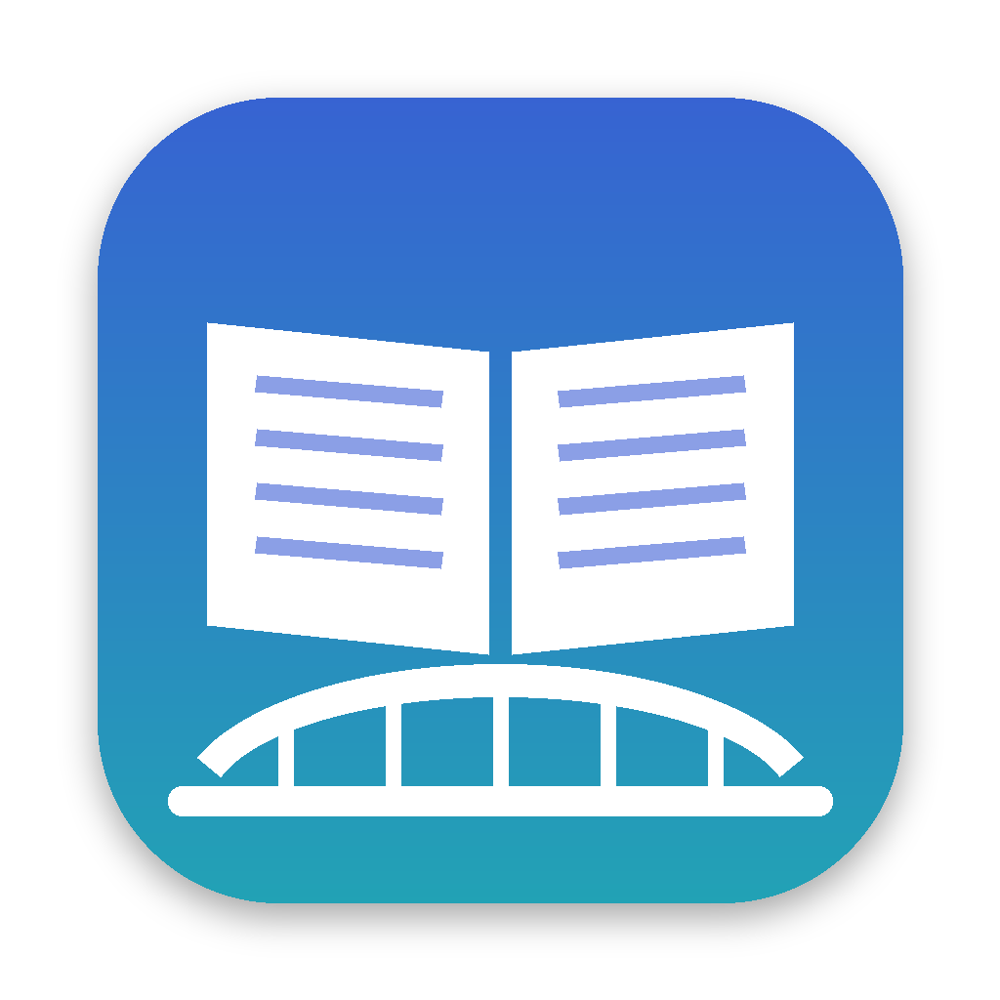

<p align="center"></p>

<h1 align="center">DictBridge for Mac</h1>

<p align="center">
把 MDict（.mdx / .mdd）词典装进 macOS 自带的「词典」App。<br>
Put MDict (.mdx / .mdd) dictionaries into the built-in macOS Dictionary app.
</p>

<p align="center">
<a href="../../releases/latest">下载 Download</a> ·
<a href="#使用">使用</a> ·
<a href="#常见问题">常见问题</a> ·
<a href="docs/how-it-works.md">工作原理</a> ·
<a href="#english">English</a>
</p>

---

macOS 的「词典」最好用的地方，是它和整个系统连在一起：在网页、PDF、邮件，或者任何一个 App 里看到不认识的词，选中它，用触控板重按一下，释义就直接在原地弹出来。不用切换窗口，也不用复制粘贴。

可惜它只认苹果自己的 `.dictionary` 格式，没法直接导入大家常用的 MDict 词典。我做 DictBridge，就是想让朗文、牛津、柯林斯这些常用的 MDict 词典，也能这样重按一下就查到。

> 💡 重按查词要在「系统设置 → 触控板 → 光标与点按」里打开「查询与数据检测器」。没有 Force Touch 触控板的话，可以改成「三指轻点」，或者选中文字后按 ⌃⌘D。

DictBridge 负责格式转换。把 `.mdx` 拖进窗口，它会读出词条、发音和图片，生成「词典」App 能识别的格式，装进 `~/Library/Dictionaries`，并在「词典」里自动启用。装好的词典都列在窗口里，不想要了随时可以删掉。

## 功能

- **拖进来就行**：同一文件夹里的 `.mdd`（包括 `name.1.mdd`、`name.2.mdd` 这样的分卷）、`.css` 和 `.js` 会自动一起导入。
- **尽量保持原样**：保留原词典的排版样式、配图、真人发音和词条间的交叉链接。变形词也能跳到原形，比如搜 went 会显示 go。
- **查词更顺手**：
  - 带音节点的词头（`ap·ple`、`ap.ple`）直接搜 apple 就能找到，结果列表里也显示成 apple。
  - 中文词头支持简繁互查：搜「苹果」也能找到「蘋果」。不需要的话，可以在导入时的「高级」里关掉。
- **省心**：
  - 编码自动识别：有些词典文件里标的是 GBK 或 Big5，实际内容却是 UTF-8，DictBridge 会自动识别，不会出现乱码。
  - 转换完成后自动在「词典」里启用新词典，并重启「词典」App 让它生效。
  - 重新导入同一部词典时，会替换掉旧版本，旧版移到废纸篓。
- **针对「词典」App 做了适配**（详见 [docs/how-it-works.md](docs/how-it-works.md)）：
  - 修复了词与词之间空格丢失的问题。
  - 展开按钮（例句、搭配、词源等）可以正常点击，发音按钮可以播放。
  - 重按弹出的查询窗口只显示每部词典的开头几行，而且点不动。DictBridge 会在这个窗口里隐藏按钮、菜单和发音图标，让释义排到最前面。
  - 只使用词条实际引用的样式表，避免词典自带的几套备选样式互相覆盖。
  - 词典脚本只保存一份，所有词条共用，大型词典转换后不会因此变大。
- **词典管理**：列出 `~/Library/Dictionaries` 里的所有词典。删除时移到废纸篓，之后还能恢复。
- **格式支持**：
  - MDict 1.2 和 2.0
  - UTF-8、UTF-16、GBK、Big5 编码
  - zlib 和 LZO 压缩
  - 加密索引（`Encrypted="2"`）
- **命令行工具** `dictbridge`：方便批量处理或写脚本。

## 安装

1. 从 [Releases](../../releases/latest) 下载 `DictBridge-x.y.z.dmg`，把 DictBridge 拖进「应用程序」。
2. 第一次打开时，macOS 可能提示「无法验证开发者」，因为当前版本还没有经过 Apple 公证。有两种处理方法：
   - 打开「系统设置 → 隐私与安全性」，在页面下方点「仍要打开」；
   - 或者在终端里运行：
     ```bash
     xattr -dr com.apple.quarantine /Applications/DictBridge.app
     ```
3. 第一次转换前，DictBridge 会请你下载苹果的 **Dictionary Development Kit**（约 1.5 MB）。苹果的许可不允许把它打包进本软件，所以它会从[公开镜像](https://github.com/nanoskript/dictionary-development-kit)下载，每个文件都会用写死在代码里的 SHA-256 校验。如果你装过苹果的「Additional Tools for Xcode」，也可以直接选择其中的 Dictionary Development Kit 文件夹。

系统要求：macOS 13 Ventura 或更新版本，Apple 芯片和 Intel 芯片的 Mac 都可以用。

## 使用

1. 打开 DictBridge，把 `.mdx` 文件（或包含它的文件夹）拖进窗口，也可以点「添加词典…」选择文件。
2. 确认「词典」里显示的名称，选择是否包含发音音频（音频往往占大部分体积），然后点「转换并安装」。
3. 完成后打开「词典」App。新词典会自动启用。你可以到「词典 → 设置」里拖动调整它的顺序。

转换时间主要取决于词条数量：

| 词典 | 词头数 | 用时（Apple 芯片） |
|---|---|---|
| 柯林斯英语同义词字典 | 约 1.2 万 | 约 20 秒 |
| 21 世纪英汉汉英双向词典 | 约 21 万 | 约 5 分钟 |
| 朗文当代第 6 版英汉双解（含 1.2 GB 发音和图片） | 约 27 万 | 约 5 分钟 |

转换过程中需要几 GB 的临时空间，结束后会自动清理。

### 已测试过的词典

以下词典已经成功转换并装进「词典」App：

| 词典 | 格式特点 |
|---|---|
| 朗文当代高级英语辞典第 6 版英汉双解（LDOCE6++ En-Cn） | MDict 2.0、加密索引、1.2 GB 的发音和图片资源 |
| 21 世纪英汉汉英双向词典 | MDict 1.2、LZO 压缩；标称 Big5，实际是 UTF-8；词头带音节点 |
| 柯林斯高阶英汉双解 | MDict 2.0、加密索引、外部 CSS |
| 葛传椝英语惯用法词典 | 带约 49 MB 的 `.mdd` 资源 |
| Stedman's Medical Dictionary | 没有样式表的纯文本词典 |
| 柯林斯英语同义词字典（Collins Thesaurus） | MDict 1.2、GBK 编码 |

转换了别的词典？不管成功还是出了问题，都欢迎[提 Issue](../../issues) 告诉我们。

### 命令行

命令行工具在 App 里面。想在终端里直接输入 `dictbridge`，可以先建一个链接：

```bash
sudo ln -s /Applications/DictBridge.app/Contents/Resources/dictbridge /usr/local/bin/dictbridge
```

常用命令：

```bash
dictbridge convert ~/Dicts/LDOCE6/LDOCE6.mdx --name "朗文当代 6"   # 转换并安装
dictbridge list                                                  # 列出已安装的词典
dictbridge remove "朗文当代 6"                                    # 移到废纸篓
dictbridge info some.mdx                                         # 查看 MDict 文件信息
dictbridge ddk --download                                        # 下载苹果的词典开发工具
```

`convert` 的常用选项：

| 选项 | 作用 |
|---|---|
| `--name <名称>` | 在「词典」里显示的名称 |
| `--no-audio` | 不包含发音音频 |
| `--no-chinese-variants` | 不加简繁互查的检索词 |
| `--headword auto\|always\|never` | 是否在词条顶部补上词头 |
| `--no-install --output <文件夹>` | 只生成 `.dictionary`，不安装 |
| `--keep-work` | 保留中间文件，方便排查问题 |

运行 `dictbridge help` 查看全部选项。

## 常见问题

**转换完了，在「词典」里看不到新词典？**
DictBridge 会自动启用新词典并重启「词典」App。如果还是没看到，到「词典 → 设置」里找到它并勾选。

**重按查词时，怎么让新词典排在前面？**
重按弹出的查询窗口会按「词典 → 设置」里的顺序显示各部词典。把新词典拖到列表上方就行。

**某个词搜不到？**
先确认这部词典已经勾选。MDict 查词比较宽松，「词典」App 要求检索词完全匹配。DictBridge 已经补上了去掉音节点、简繁转换后的检索词。如果还有搜不到的情况，欢迎提 Issue，附上词典名称和搜不到的词。

**怎么更新或删除词典？**
- 更新：重新导入同一个 `.mdx`，新版本会替换旧版本。
- 删除：在 DictBridge 的列表里点垃圾桶图标，词典会被移到废纸篓。

**排版和原来不一样？**
「词典」App 的显示引擎和 MDict 软件不完全相同，个别样式可能有出入。反馈时请附上出问题的词条截图和 App 里的日志（转换完成后展开「日志」，点「复制日志」）。

## 已知限制

- 不支持 MDict 3.0 新格式。
- 需要注册码才能打开的词典（`Encrypted="1"`）只能尽力读取，不保证成功。
- `.mdd` 文件要和 `.mdx` 同名（`name.mdd`、`name.1.mdd`……）才会被识别。
- 样式表只用词条里引用的那几个，外加和词典同名的 `.css`；都没有时，才用 `.mdx` 旁边的 `.css`。词典文件夹里的文件优先于 `.mdd` 里的同名文件，所以想换样式，把改好的 `.css` 放在 `.mdx` 旁边就行。
- `.spx`（Speex）格式的发音，「词典」App 无法播放。
- 在重按（或三指轻点）弹出的查询窗口里，每部词典只显示开头几行，点击展开和播放发音都不起作用。这是「词典」App 本身的限制。点窗口里的「更多」，可以在「词典」App 里看完整内容，那里一切正常。

## 从源码构建

```bash
git clone https://github.com/Andy7016/DictBridge-for-Mac.git && cd DictBridge-for-Mac
swift build && swift test          # 需要 Xcode 15 或更新版本（Swift 5.9+）
swift run DictBridgeApp            # 直接运行 App
scripts/build-app.sh               # 生成 dist/DictBridge.app、.zip 和 .dmg
scripts/compat-test.sh ~/词典库     # 把文件夹里的词典逐个转换（不安装），输出一张兼容性结果表
```

| 目录 | 内容 |
|---|---|
| `Sources/MDictKit` | 纯 Swift 编写的 MDict 读取器：索引、zlib/LZO 解压、RIPEMD-128 解密、多种编码 |
| `Sources/DictBridgeCore` | 转换流程：HTML→XHTML、链接与资源处理、检索词、CSS 适配、调用苹果编译工具、词典库管理 |
| `Sources/DictBridgeApp` | SwiftUI 界面 |
| `Sources/dictbridge` | 命令行工具 |
| `scripts/make_fixtures.py` | 生成测试用的小型合成词典（不包含任何第三方词典内容） |

每次推送都会由 GitHub Actions 自动编译、运行测试，并用苹果的工具实际转换一部测试词典。在 GitHub 上发布 Release 后，打包好的 `.dmg` 和 `.zip` 会自动附加到这个 Release 上。

欢迎提交 Issue 和 PR，尤其欢迎反馈某部词典转换后显示不正常的问题。反馈时请附上词典名称、出问题的词条截图和 App 里的日志，但请不要上传词典文件本身。

## 版权说明

DictBridge 只是格式转换工具，不包含、也不分发任何词典内容。请只转换你有权使用的词典文件，转换结果仅供个人使用。

---

## English

The best thing about the macOS Dictionary is that it is built into the whole system: select a word in any app (a web page, a PDF, an email) and force-click it on the trackpad, and the definition pops up right there. No switching windows, no copy and paste. (Turn on *Look up & data detectors* in System Settings → Trackpad; a three-finger tap or ⌃⌘D works too.)

But it only reads Apple's `.dictionary` bundles, not the MDict dictionaries most learners use. DictBridge exists so that those dictionaries can be looked up the same way. It converts MDict dictionaries (`.mdx` + `.mdd` + `.css`) into that format, installs them into `~/Library/Dictionaries` and enables them in Dictionary. Its window lists your installed dictionaries so you can remove them again.

**Features**
- Drop an `.mdx` file in. Companion `.mdd` files (including `name.1.mdd`, `name.2.mdd`…), `.css` and `.js` files in the same folder come along automatically.
- Keeps styles, pictures, audio pronunciations, cross-references and redirect entries (inflections such as *went → go*).
- Finds what MDict users expect: syllable-dotted headwords (`ap·ple`) are found as *apple*, and Chinese headwords are found in both Simplified and Traditional script.
- Detects dictionaries that declare GBK or Big5 but actually contain UTF-8.
- Enables new dictionaries in Dictionary automatically and replaces an older version of the same dictionary.
- Handles Dictionary.app quirks: lost spaces, clickable expanders, playable audio. In the force-click popover, which shows only the start of each entry and ignores clicks, buttons and speaker icons are hidden so the definition comes first. See [docs/how-it-works.md](docs/how-it-works.md).
- Uses only the style sheets the entries link to, and keeps one shared copy of each script.
- Supports MDict 1.2/2.0; UTF-8, UTF-16, GBK and Big5 encodings; zlib and LZO compression; encrypted key index (`Encrypted="2"`).
- Includes a `dictbridge` command-line tool (`DictBridge.app/Contents/Resources/dictbridge`; run `dictbridge help`).

**Install.** Download the `.dmg` from [Releases](../../releases/latest). The app is not notarized yet, so on first launch go to System Settings → Privacy & Security → *Open Anyway*, or run `xattr -dr com.apple.quarantine /Applications/DictBridge.app`.

The first conversion asks to download Apple's Dictionary Development Kit (about 1.5 MB). Apple's licence does not allow bundling it, so it is fetched from a [public mirror](https://github.com/nanoskript/dictionary-development-kit) and checked against SHA-256 hashes pinned in the source. You can point DictBridge at your own copy from *Additional Tools for Xcode* instead.

Requires macOS 13 or later, on Apple silicon or Intel.

**Known limitations.** No MDict 3.0. Dictionaries that need a registration key (`Encrypted="1"`) are read on a best-effort basis. `.mdd` files must share the `.mdx` file's name. Files next to the `.mdx` override same-named files in the `.mdd`. In the popover, clicks (expanders, audio) do nothing; use *More* to open the full entry. `.spx` audio does not play.

**Build.** Run `swift build && swift test`, then `scripts/build-app.sh` to produce `dist/DictBridge.app`.

**Copyright.** DictBridge ships no dictionary content. Only convert dictionaries you have the right to use.

## License

MIT. See [LICENSE](LICENSE) and [THIRD_PARTY_NOTICES.md](THIRD_PARTY_NOTICES.md).
